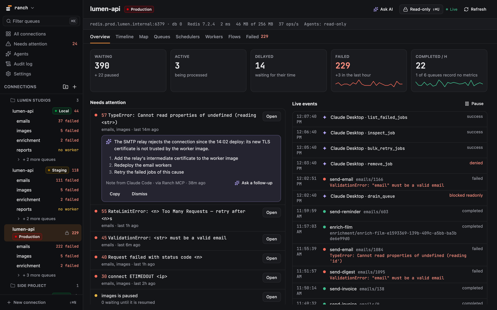

<p align="center">
  <picture>
    <source media="(prefers-color-scheme: dark)" srcset=".github/assets/ranch-lockup-dark.png">
    
  </picture>
</p>

<p align="center">
  A desktop client for your BullMQ queues: see what is waiting, running and failing,<br>
  drill into a job, retry or clean up, and let your AI agents do the same, under your control.
</p>

<p align="center">
  <a href="https://ranch.bramvanosta.com"><b>Website</b></a> ·
  <a href="#installation"><b>Download</b></a> ·
  <a href="#features"><b>Features</b></a> ·
  <a href="#ai-agents-mcp"><b>AI agents</b></a> ·
  <a href="#ranch-server-docker"><b>Ranch server</b></a> ·
  <a href="CHANGELOG.md"><b>Changelog</b></a>
</p>

<p align="center">
  
  
  
  
  <a href="LICENSE"></a>
</p>

<p align="center">
  <picture>
    <source media="(prefers-color-scheme: light)" srcset=".github/assets/screenshot-light.png">
    
  </picture>
</p>

## Contents

- [Why Ranch](#why-ranch)
- [Installation](#installation)
- [Features](#features)
- [AI agents (MCP)](#ai-agents-mcp)
- [Ranch server (Docker)](#ranch-server-docker)
- [Development](#development)
- [Tech stack](#tech-stack)
- [Contributing](#contributing)
- [License](#license)

## Why Ranch

- **A desktop app first.** It runs on your machine, talks to Redis directly (locally, over TLS or through an SSH tunnel) and keeps your secrets in the OS keychain. Where a desktop app does not fit, the same UI runs as a [Docker image](#ranch-server-docker).
- **Every connection in one window.** Projects, environments and Redis instances side by side, with what needs you first.
- **Safe on production.** Production connections are read-only until you unlock them, every destructive action shows its count before it runs, and every write lands in an audit log.
- **Writes are BullMQ-exact.** Retry, promote, add, drain, clean and schedulers go through Lua scripts ported from BullMQ's own, proven in CI by real BullMQ **5.x and 6.x** workers processing the result.
- **AI agents, on a leash.** The built-in MCP server gives your agents the same queues: reads are free, writes wait for your approval in Ranch.

## Installation

Download the latest build from the [Releases](../../releases/latest) page.

### macOS

Open the `.dmg` (one signed and notarized universal app, for Apple Silicon and Intel) and drag Ranch into Applications. Or with Homebrew:

```bash
brew install --cask bramvanosta/tap/ranch        # stable releases
brew install --cask bramvanosta/tap/ranch@beta   # release candidates and stable releases
```

### Linux

```bash
sudo apt install ./Ranch_*_amd64.deb      # Debian, Ubuntu
sudo dnf install ./Ranch-*.x86_64.rpm     # Fedora, RHEL
chmod +x Ranch_*.AppImage && ./Ranch_*.AppImage
```

> [!IMPORTANT]
> Ranch stores Redis and SSH passwords in the OS keychain. On Linux it needs a running Secret Service provider (GNOME Keyring, KWallet or KeePassXC), or saving a connection fails. See [docs/keychain-setup.md](docs/keychain-setup.md).

### Windows

Ranch is not packaged for Windows: build it from source (see [Development](#development)).

### Updates

The macOS app and the Linux AppImage update themselves: Ranch checks at start, shows the release notes and installs only when you click (Settings › Updates). A `.deb` or `.rpm` install is updated through your package manager.

## Features

### Connections

- **Groups, environments, connections.** Arrange them by project and environment, with a color per environment; drag and drop to reorder.
- **Every way to reach Redis.** `redis://` and `rediss://` URLs, TLS with a custom CA, SSH tunnels, secrets in the OS keychain.
- **A new connection in two steps.** Paste a URL or fill the fields, test, then see what Ranch found (latency, Redis version, the BullMQ queues, schedulers and workers) before you name and file it.
- **One connection per Redis, kept open.** Fast on a remote Redis: shared by every screen, reopened by itself after a drop, with reads running side by side.

### Triage

- **All connections at a glance.** One table per group: health and latency trend, queues, waiting, failed, workers, protection. An unreachable connection says why in plain words.
- **Needs attention.** Failing causes, stuck queues (paused too long, or jobs waiting with no worker) and offline connections across every connection, most urgent first, each with the action that fixes it.
- **Failures grouped by cause.** Reasons that only differ by their values fold into one group, with its count, job types and last 24 hours. Retry or remove a whole group at once.
- **⌘K reaches everything.** Queues, connections, pages, actions and jobs (`#1211`) from one palette.

### Queues and jobs

- **Per connection:** an overview (throughput, failure rate, timings from 5 minutes to 7 days), every queue with live counters, every failed job of every queue in one view, a timeline and a map of the queues.
- **Per queue:** jobs by state with server-side search, sort and paging across the whole queue; running jobs with their progress against the usual time of their type; schedulers (create, edit, pause, delete, with the next runs); flows; workers, and a warning when nothing consumes the queue.
- **Per job:** payload, options, progress, stack traces, return value, logs, and its flow as a graph. Retry, promote, remove, also in bulk and across queues.
- **Add Job** with a payload editor that validates as you type, and the matching `queue.add(...)` to copy.
- **Maintenance:** retry all failed, clean, drain, each with a count and a confirmation first.

### Safety

- **Production is locked** until you unlock it for the session.
- **An audit log** of every write (yours and your agents'), filterable and exportable as CSV or JSON.
- **Light and dark themes**, both checked for WCAG AA text contrast.

## AI agents (MCP)

Ranch ships an MCP server, `ranch-mcp`, that works with the connections you set up in the app.

- **One-click setup** for Claude Desktop, Claude Code, Cursor, Codex and Windsurf (Agents › Setup & safety).
- **Reads are free, writes need you.** An agent's write opens an approval in Ranch: what it would do, to how many jobs, the exact call. Approve once or deny.
- **Per-connection access:** read-only, ask, or free. A global switch turns every AI feature off.
- **Job data you choose to share:** sensitive fields masked by default (email, token, password, card numbers…), or names and errors only.
- **Notes on failures:** an agent that found why jobs fail attaches its diagnosis to the cause, shown on the Failed tab.
- **Ask AI** on a job, a cause or a connection hands the problem to your agent with the context ready.

> *“Why are jobs failing in the emails queue on production since this morning?”*
>
> *“Retry the failed stripe-webhooks jobs that timed out, and tell me how many.”*

The full list of tools is in [docs/mcp-tools.md](docs/mcp-tools.md).

## Ranch server (Docker)

The same UI, served over HTTP by the same Rust core, for the places a desktop app does not go: next to a staging Redis, in a compose stack, in a cluster.

```bash
# Once: the key that encrypts the passwords Ranch stores. Keep this file.
(umask 077 && openssl rand -base64 32 > ranch-secret.key)

docker run -d --name ranch -p 127.0.0.1:8080:8080 -v ranch-data:/data \
  -e RANCH_PASSWORD='choose-one' -e RANCH_SECRET_KEY="$(cat ranch-secret.key)" \
  ghcr.io/bramvanosta/ranch:latest
```

Recreate the container with the same key: with another one, the passwords already stored cannot be read. Open http://localhost:8080 (user `ranch`) and put TLS in front before exposing it beyond localhost. Configuration, sign-in with OIDC, the security model and what the image does not do are in [docs/server.md](docs/server.md).

## Development

### Prerequisites

- [mise](https://mise.jdx.dev), which installs Rust and Node from `mise.toml`.
- [pnpm](https://pnpm.io), activated through `corepack`.
- The [Tauri system dependencies](https://v2.tauri.app/start/prerequisites/) for your platform.
- **Linux only:** a Secret Service provider, as above ([docs/keychain-setup.md](docs/keychain-setup.md)).

### Run the desktop app

```bash
mise install
corepack enable
pnpm install
pnpm tauri:dev
```

### Ranch web: the UI in a browser, without Redis

```bash
pnpm dev            # then open http://localhost:1420
```

Outside Tauri, a development build swaps the backend for an in-memory BullMQ world (`src/backend/fake/`): groups, a local / staging / locked-production trio, an unreachable Redis, queues with jobs in every state, schedulers, workers, a flow, an audit trail and agent activity. Every screen can be clicked through, and writes act on the demo world; a reload starts over. `?preview=empty` shows a first launch, and `ranchPreview.requestApproval()` in the browser console queues an agent write. The demo world is not in production bundles.

### Checks

```bash
pnpm check                                # format, Biome, types, unit tests
(cd src-tauri && cargo test --workspace)
pnpm check:overflow                       # no clipped or overlapping text, when you touched the UI
```

[docs/testing.md](docs/testing.md) covers every suite, including the ones against a real Redis and real BullMQ workers.

<details>
<summary>A local build to look at</summary>

```bash
pnpm tauri build --debug --bundles app --config '{"bundle":{"createUpdaterArtifacts":false}}'
open src-tauri/target/debug/bundle/macos/Ranch.app
```

`createUpdaterArtifacts` is switched off because signing the updater bundle needs the release key.

</details>

### Project structure

```
src/                        React front end
├── features/<area>/        screens and hooks, one folder per area, used through index.ts
├── data/<resource>/        queries and mutations: the only callers of the backend
├── capabilities/           what a connection's backend can do
├── domain/                 pure front-end modules (job states, formatting…)
├── backend/fake/           the in-memory demo world of Ranch web
├── components/, commands/  shared UI; the command registry behind menus and ⌘K
└── lib/tauri/bindings.ts   generated from the Rust contract
src-tauri/                  Rust workspace; the root is the app crate, ranch
├── src/commands/           the operations and their Tauri commands
├── src/contract/           the wire types
├── src/shells/mcp/         the MCP server (ranch-mcp)
├── src/server/             the HTTP server (ranch-server, the Docker image)
├── src/core/               the agent policy: gate, approvals, sharing, activity
├── crates/domain/          ranch-domain: types and rules, no I/O
├── crates/application/     ranch-application: the catalogue, the write pipeline, the ports
├── crates/secrets/         ranch-secrets: OS keychain, encrypted file
├── crates/sqlite/          ranch-sqlite: the database, migrations, audit log
├── crates/bullmq-redis/    ranch-bullmq-redis: connection actors, BullMQ's Lua scripts
└── tests/                  integration tests
```

[docs/architecture.md](docs/architecture.md) explains how the pieces fit, [docs/design.md](docs/design.md) is the design system, and [docs/adr/](docs/adr/README.md) records the decisions behind the shape.

## Tech stack

| | |
|---|---|
| **App shell** | Tauri v2 |
| **Front end** | React 19, TypeScript, Vite, Tailwind CSS v4, Lucide icons |
| **Core** | Rust, Tokio, `redis` with rustls, `rmcp` for the MCP server, Axum for Ranch server |
| **Tooling** | Biome, Vitest, Playwright, lefthook, mise |

## Contributing

Issues and pull requests are welcome: see [CONTRIBUTING.md](CONTRIBUTING.md).

## License

[MIT](LICENSE)
